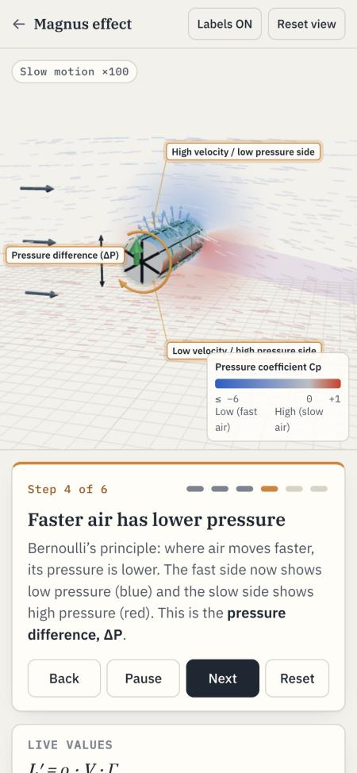
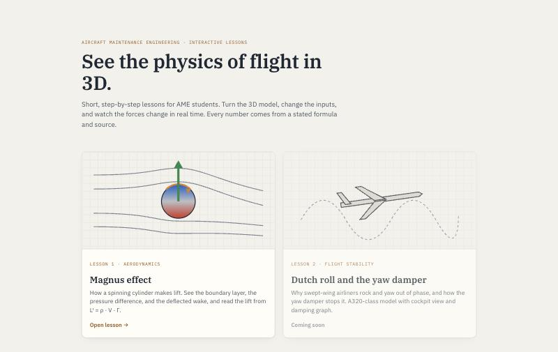

# AME 3D Lessons

Interactive, step-by-step 3D lessons in aerodynamics and flight stability for **Aircraft Maintenance Engineering (AME)** students.

**Live site:** https://aswinguruswamy.github.io/ame-3d-lessons/

| Lesson | Status |
| --- | --- |
| 1. Magnus effect: lift from a spinning cylinder | ✅ Live |
| 2. Dutch roll and the yaw damper (A320-class) | 🛠 In progress |


<p>
  
  
</p>

## Purpose

Textbooks show the Magnus effect and Dutch roll as flat diagrams. These lessons let a student:

- **turn the 3D model** and look at the flow from any side,
- **step through the idea** one cause at a time (Back / Next / Play-Pause / Reset),
- **change the inputs** (spin rate, airspeed, direction) and see the forces change live,
- **read real numbers** from the stated formula. Every constant has a source.

## Lesson 1: Magnus effect

A cylinder sits in a uniform airflow. When it spins, it pulls a thin boundary layer around with it. Air on one side speeds up and air on the other side slows down. Bernoulli's principle turns that speed difference into a pressure difference, and the result is a lift force, L′ = ρ · V · Γ (Kutta–Joukowski).

What you see:

- animated air particles drawn as wind-tunnel "smoke rakes" on three planes,
- a pressure colour map on the cylinder, on the air, and on a back-wall slice (blue = low, red = high), with a legend,
- surface pressure arrows (length ∝ local gauge pressure p − p∞),
- a lift arrow drawn to scale, a ΔP indicator, and the deflected wake,
- eight placards with leader lines. The labels for the current step are highlighted, and a Labels ON/OFF toggle hides them all.

Checks (automated in `tests/magnus.test.ts`):

- With spin OFF, the flow is symmetric and the lift is exactly 0.
- Reversing the spin direction reverses the lift.
- The lift from Kutta–Joukowski equals the lift from integrating the surface pressure (to 6 decimal places).
- No flow passes through the surface, and the flow returns to the free stream far away.

## Tech stack

| Part | Choice | Why |
| --- | --- | --- |
| Build | **Vite** (multi-page) | The landing page ships **no JavaScript**. Each lesson is its own page. |
| Language | **TypeScript** (strict) | The physics is typed and testable. |
| 3D | **Three.js** | Orbit controls, instanced meshes, no post-processing. Loaded **only** when a lesson opens (dynamic `import()`). |
| Labels | `CSS2DRenderer` | Placards are HTML, so the text stays sharp at any zoom. |
| Tests | **Vitest** | The physics checks run in CI before every deploy. |
| Hosting | **GitHub Pages** via GitHub Actions | Free, with a public URL. |

Performance budget:

- Landing page: about 4 KB gzipped (HTML + CSS).
- Lesson shell: about 7 KB of JS. The 3D chunk (Three.js + scene) is about 148 KB gzipped.
- Measured frame cost with every layer on: about 2.3 ms of JS per frame on a laptop, well inside the 16.7 ms budget for 60 fps.
- The pixel ratio is capped (2 on desktop, 1.5 on touch devices).
- Phones get fewer particles.

## Physics model and sources

All values are in [`src/config/magnus.ts`](src/config/magnus.ts), with comments. Values marked **APPROXIMATE** are simplifications for teaching.

| Value | Used | Source |
| --- | --- | --- |
| Air density ρ | 1.225 kg/m³ (ISA sea level) | ICAO Doc 7488/3, *Manual of the ICAO Standard Atmosphere* |
| Flow field | Uniform flow + doublet + vortex (ideal 2-D potential flow) | J. D. Anderson, *Fundamentals of Aerodynamics*, 6th ed., Ch. 3 |
| Lift per span | L′ = ρ · V · Γ (Kutta–Joukowski) | Anderson, Ch. 3 |
| Circulation | Γ = 2π r² ω, **APPROXIMATE** (ideal no-slip estimate) | NASA Glenn, [*Lift of a Rotating Cylinder*](https://www.grc.nasa.gov/www/k-12/airplane/cyl.html) |
| Lift limit | Γmax = 4π r V (spin ratio α ≤ 2), **APPROXIMATE** (Prandtl's limit) | NASA Glenn (above); Anderson, Ch. 3 |
| Real-cylinder lift is lower than ideal | Stated on screen | W. M. Swanson, "The Magnus Effect: A Summary of Investigations to Date", *J. Basic Eng.* 83(3), 1961 |
| Wake deflection angle | δ = 0.3 · α (max 0.55 rad), **APPROXIMATE, visual only** | Teaching model. Ideal flow has no wake. |
| Cylinder radius | 0.05 m | Illustrative wind-tunnel model |

## Run locally

Requires Node 20+.

```bash
git clone https://github.com/aswinguruswamy/ame-3d-lessons.git
cd ame-3d-lessons
npm install
npm run dev      # http://localhost:5183
npm test         # physics checks
npm run build    # production build in dist/
```

## Folder structure

```
index.html                  Landing page (no JS)
lessons/magnus/index.html   Lesson 1 page shell
src/
  config/magnus.ts          All Lesson 1 physics values + sources
  lessons/magnus/
    physics.ts              Flow field, pressure, lift (no 3D code, unit-tested)
    scene.ts                Three.js scene (lazy-loaded)
    main.ts                 UI, tutorial steps, readout
  shared/                   Viewer, placards, arrows, tutorial engine, controls, colour map
  styles/                   CSS
tests/                      Vitest physics tests
.github/workflows/          Test + deploy to GitHub Pages
```

## Disclaimer

For education only. Not for operational or maintenance use. Always follow the approved aircraft documentation.
