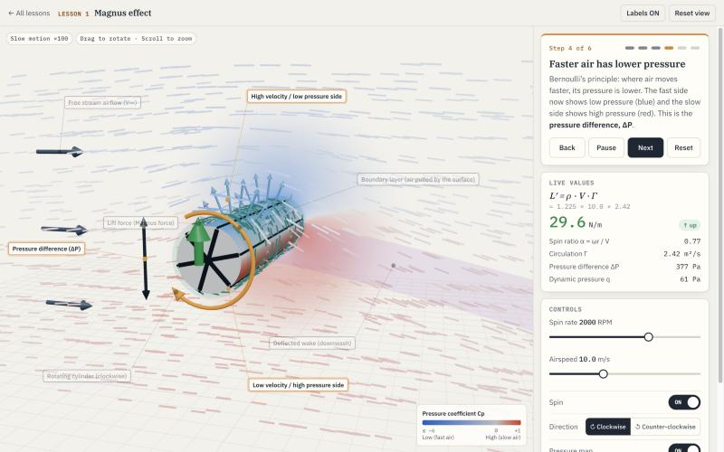
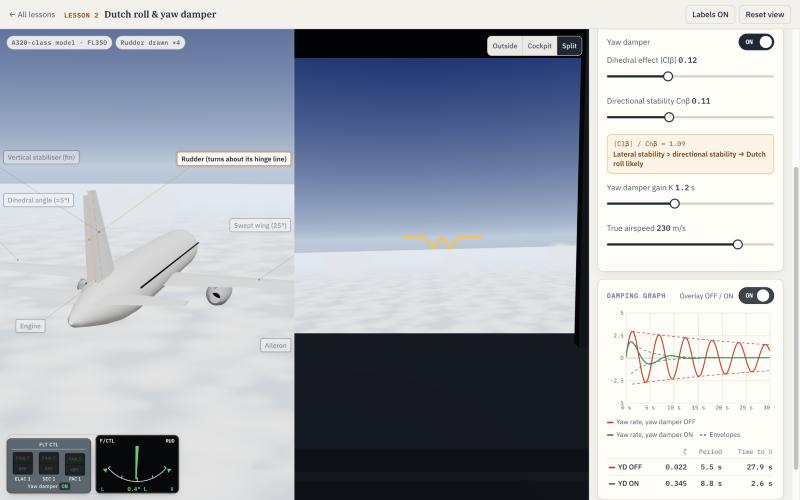
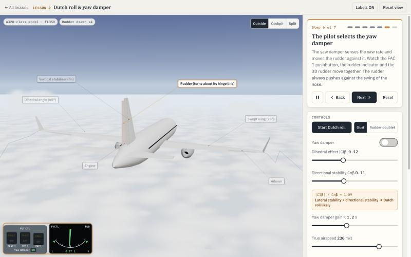
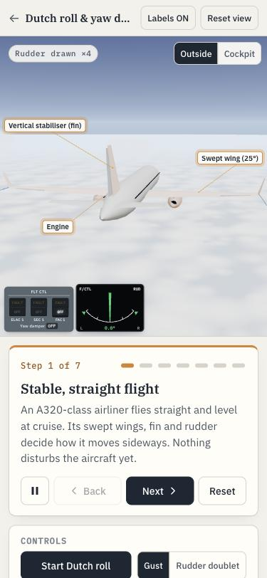

# AME 3D Lessons

Interactive, step-by-step 3D lessons in aerodynamics and flight stability for **Aircraft Maintenance Engineering (AME)** students.

**Live site:** https://aswinguruswamy.github.io/ame-3d-lessons/

| Lesson | Status |
| --- | --- |
| 1. Magnus effect: lift from a spinning cylinder | ✅ Live |
| 2. Dutch roll and the yaw damper (A320-class) | ✅ Live |



<p>
  
  
</p>

## Purpose

Textbooks show the Magnus effect and Dutch roll as flat diagrams. These lessons let a student:

- **turn the 3D model** and look at the flow from any side,
- **step through the idea** one cause at a time (Back / Next / Play-Pause / Reset),
- **change the inputs** (spin rate, airspeed, direction) and see the forces change live,
- **read real numbers** from the stated formula. Every constant has a source.

## Lesson 1: Magnus effect

A cylinder sits in a uniform airflow. When it spins, it pulls a thin boundary layer around with it. Air on one side speeds up and air on the other side slows down. Bernoulli's principle turns that speed difference into a pressure difference, and the result is a lift force, L′ = ρ · V · Γ (Kutta–Joukowski).

What you see:

- animated air particles drawn as wind-tunnel "smoke rakes" on three planes,
- a pressure colour map on the cylinder, on the air, and on a back-wall slice (blue = low, red = high), with a legend,
- surface pressure arrows (length ∝ local gauge pressure p − p∞),
- a lift arrow drawn to scale, a ΔP indicator, and the deflected wake,
- eight placards with leader lines. The labels for the current step are highlighted, and a Labels ON/OFF toggle hides them all.

Checks (automated in `tests/magnus.test.ts`):

- With spin OFF, the flow is symmetric and the lift is exactly 0.
- Reversing the spin direction reverses the lift.
- The lift from Kutta–Joukowski equals the lift from integrating the surface pressure (to 6 decimal places).
- No flow passes through the surface, and the flow returns to the free stream far away.

## Lesson 2: Dutch roll and the yaw damper (A320-class)



<p>
  
  
</p>

Dutch roll is a coupled, oscillating motion: yaw (the nose swings left and right) and roll (the wings rock), out of phase. It happens when lateral stability (the dihedral effect) is much stronger than directional stability (the weathervane effect). Swept-wing airliners are prone to it. The yaw damper senses yaw rate and moves the rudder against it.

What you see:

- **A procedural A320-like airliner.**
  - Low swept wing with dihedral, sharklets, two engines under the wings, conventional tail. No logo and no livery.
  - The rudder is a separate part that turns about its swept hinge line. The ailerons are separate parts too.
- **Three views.**
  - Outside: a chase camera with orbit control and wingtip trails.
  - Cockpit: the pilot eye point with a glareshield and a fixed nose symbol, so the horizon rolls and the nose swings across it.
  - Split: both side by side, desktop only.
- **Theory demos.**
  - Weathervane effect: top view, relative-wind arrows and the side force on the fin.
  - Dihedral effect: rear view, sideslip and unequal wing lift.
- **Cockpit insets.**
  - An overhead FLT CTL panel inset with an animated FAC 1 pushbutton (OFF light).
  - A rudder position indicator in the style of the ECAM F/CTL page. The 3D rudder follows the same signal.
- **Controls.**
  - "Start Dutch roll" with a gust or a rudder doublet.
  - A yaw damper ON/OFF toggle, which also works during an oscillation.
  - Sliders for |Clβ|, Cnβ, yaw damper gain and airspeed.
  - A live "Dutch roll likely" label driven by |Clβ| / Cnβ.
- **Damping graph.**
  - Yaw rate, roll angle and rudder against time, with the decay envelope.
  - The damping ratio ζ, the period and the time to half amplitude.
  - An overlay mode that plots the yaw damper OFF and ON runs on the same axes.

Physics:

- Linear lateral-directional model with states β, p, r, φ (plus ψ for display).
- Fixed-step RK4 integration at 120 Hz.
- Yaw damper: δr = −K · (washed-out yaw rate), with a washout time constant τ = 2 s, actuator lag, a rate limit and position limits.
- ζ and the period come from the eigenvalues of the closed-loop system matrix (Faddeev–LeVerrier + Durand–Kerner, in `src/shared/eigen.ts`).

| Default case (FL350, 230 m/s TAS) | ζ | Period | Time to ½ amplitude |
| --- | --- | --- | --- |
| Yaw damper OFF | 0.022 | 5.5 s | 27.9 s |
| Yaw damper ON (K = 1.2 s) | 0.345 | 8.8 s | 2.6 s |

Checks (automated in `tests/dutch-roll.test.ts`):

- With the yaw damper OFF, the oscillation runs more than 6 cycles in 40 s and stays above 20 % of its amplitude.
- With the yaw damper ON, it drops below 10 % after 3 periods.
- The rudder moves against the yaw rate in more than 85 % of samples.
- The RK4 time response matches the eigenvalue decay rate (log decrement).
- The eigen solver matches a known analytic case.

## Tech stack

| Part | Choice | Why |
| --- | --- | --- |
| Build | **Vite** (multi-page) | The landing page ships **no JavaScript**. Each lesson is its own page. |
| Language | **TypeScript** (strict) | The physics is typed and testable. |
| 3D | **Three.js** | Orbit controls, instanced meshes, no post-processing. Loaded **only** when a lesson opens (dynamic `import()`). |
| Labels | `CSS2DRenderer` | Placards are HTML, so the text stays sharp at any zoom. |
| Tests | **Vitest** | The physics checks run in CI before every deploy. |
| Hosting | **GitHub Pages** via GitHub Actions | Free, with a public URL. |

Performance budget:

- Landing page: about 4 KB gzipped (HTML + CSS).
- Lesson shell: about 5–8 KB of JS. Three.js is one shared chunk of about 147 KB gzipped, loaded only when a lesson's 3D scene opens.
- Measured frame cost with every layer on: about 2.3 ms of JS per frame on a laptop, well inside the 16.7 ms budget for 60 fps.
- The pixel ratio is capped (2 on desktop, 1.5 on touch devices).
- Phones get fewer particles.

## Physics model and sources

All values are in [`src/config/magnus.ts`](src/config/magnus.ts), with comments. Values marked **APPROXIMATE** are simplifications for teaching.

| Value | Used | Source |
| --- | --- | --- |
| Air density ρ | 1.225 kg/m³ (ISA sea level) | ICAO Doc 7488/3, *Manual of the ICAO Standard Atmosphere* |
| Flow field | Uniform flow + doublet + vortex (ideal 2-D potential flow) | J. D. Anderson, *Fundamentals of Aerodynamics*, 6th ed., Ch. 3 |
| Lift per span | L′ = ρ · V · Γ (Kutta–Joukowski) | Anderson, Ch. 3 |
| Circulation | Γ = 2π r² ω, **APPROXIMATE** (ideal no-slip estimate) | NASA Glenn, [*Lift of a Rotating Cylinder*](https://www.grc.nasa.gov/www/k-12/airplane/cyl.html) |
| Lift limit | Γmax = 4π r V (spin ratio α ≤ 2), **APPROXIMATE** (Prandtl's limit) | NASA Glenn (above); Anderson, Ch. 3 |
| Real-cylinder lift is lower than ideal | Stated on screen | W. M. Swanson, "The Magnus Effect: A Summary of Investigations to Date", *J. Basic Eng.* 83(3), 1961 |
| Wake deflection angle | δ = 0.3 · α (max 0.55 rad), **APPROXIMATE, visual only** | Teaching model. Ideal flow has no wake. |
| Cylinder radius | 0.05 m | Illustrative wind-tunnel model |

### Lesson 2 sources

All values are in [`src/config/dutchRoll.ts`](src/config/dutchRoll.ts). Airbus does not publish A320 stability derivatives, so the aerodynamic values are typical swept-wing twin-jet values, marked **APPROXIMATE, for teaching**.

| Value | Used | Source |
| --- | --- | --- |
| Span, length, height | 34.1 m, 37.57 m, 11.76 m | Airbus, *A320 Aircraft Characteristics – Airport and Maintenance Planning* |
| Wing area, sweep | 122.6 m², 25° | Airbus A320 family technical data |
| Dihedral | ≈ 5.1°, **APPROXIMATE** | Commonly quoted value |
| Air density at FL350 | 0.3796 kg/m³ | ICAO Doc 7488/3 (ISA) |
| Mass, Ixx, Izz | 64 t, 1.2e6, 4.0e6 kg·m², **APPROXIMATE** | Estimated with radii of gyration from J. Roskam, *Airplane Flight Dynamics and Automatic Flight Controls*, Part I |
| Cyβ, Clβ, Cnβ, Clp, Clr, Cnp, Cnr, rudder derivatives | Typical jet-transport values, **APPROXIMATE, for teaching** | R. C. Nelson, *Flight Stability and Automatic Control*, 2nd ed.; Roskam Part I; Heffley & Jewell, NASA CR-2144 (1972) |
| Lateral equations, Dutch roll, yaw damper with washout | Model structure | Nelson, Ch. 5 and Ch. 10 |
| Yaw damper authority, rudder travel and rate limits, washout τ | 10°, 10°, 25°/s, 2 s, **APPROXIMATE** | Typical values; see A320 FCOM DSC-27 for the aircraft |
| "Dutch roll likely" limit | \|Clβ\| / Cnβ > 1.0, **APPROXIMATE, for teaching** | Rule of thumb, not a certification criterion |

**Overhead panel note:** the FAC 1 pushbutton inset follows the public description of the A320 overhead FLT CTL panel (FCOM DSC-27). There, FAC 1 sits with ELAC 1 and SEC 1, and the button has a FAULT light (amber) and an OFF light (white). I did not have access to a current FCOM, so check the layout against it before using this for type training. As a teaching simplification, FAC 1 is treated as "the yaw damper". On the aircraft, FAC 2 is a back-up.

## Run locally

Requires Node 20+.

```bash
git clone https://github.com/aswinguruswamy/ame-3d-lessons.git
cd ame-3d-lessons
npm install
npm run dev      # http://localhost:5183
npm test         # physics checks
npm run build    # production build in dist/
```

## Folder structure

```
index.html                  Landing page (no JS)
lessons/magnus/index.html   Lesson 1 page shell
lessons/dutch-roll/index.html  Lesson 2 page shell
src/
  config/magnus.ts          All Lesson 1 physics values + sources
  config/dutchRoll.ts       All Lesson 2 physics values + sources
  lessons/magnus/
    physics.ts              Flow field, pressure, lift (no 3D code, unit-tested)
    scene.ts                Three.js scene (lazy-loaded)
    main.ts                 UI, tutorial steps, readout
  lessons/dutch-roll/
    physics.ts              Linear model, RK4, yaw damper, eigen-based ζ (unit-tested)
    aircraft.ts             Procedural A320-like model (rudder/ailerons on hinge lines)
    scene.ts                Sky, clouds, views, demos, trails (lazy-loaded)
    panels.ts               Overhead FAC pushbutton + rudder indicator (SVG)
    graph.ts                Live damping graph (Canvas 2D)
    main.ts                 UI, tutorial steps, physics loop
  shared/                   Viewer, placards, arrows, tutorial engine, controls, colour map
  styles/                   CSS
tests/                      Vitest physics tests
.github/workflows/          Test + deploy to GitHub Pages
```

## Disclaimer

For education only. Not for operational or maintenance use. Always follow the approved aircraft documentation.
